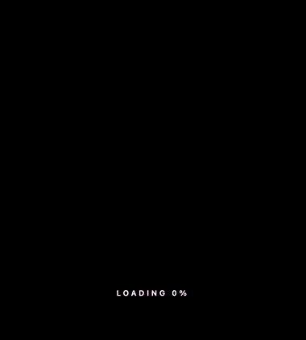
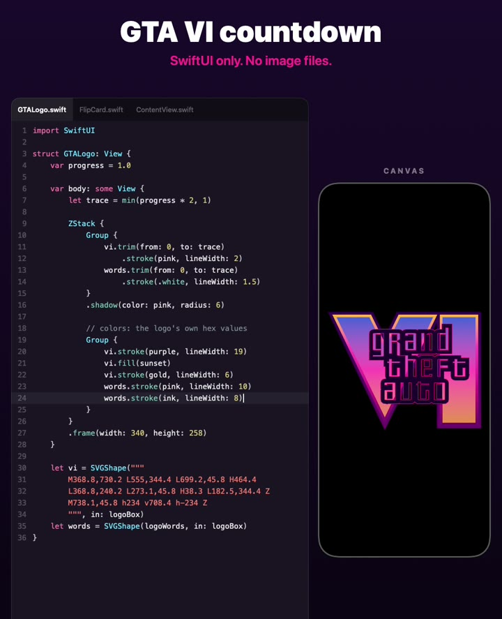
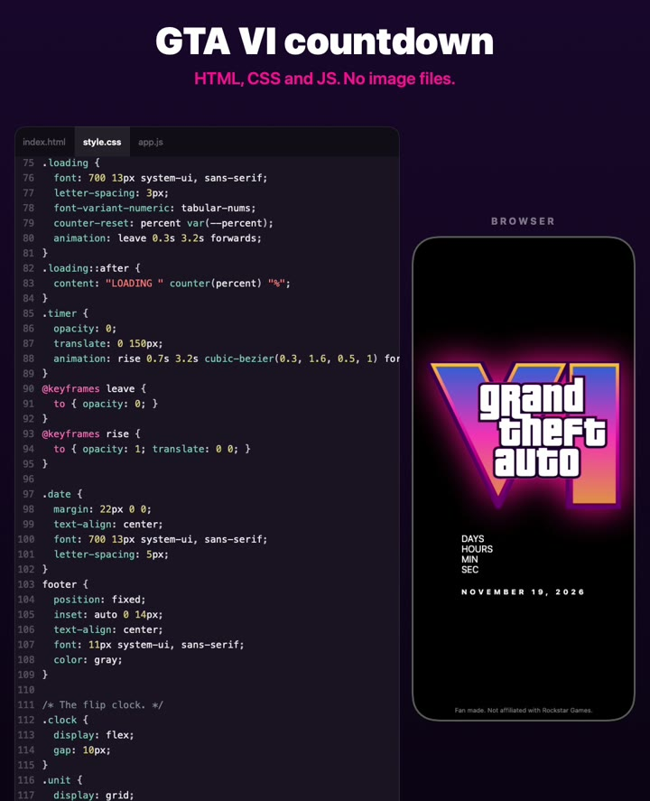

# GTA 6 Countdown

The GTA VI loading screen and a launch countdown, built with zero image files. Once in SwiftUI for iOS, and once for the web with HTML, CSS and JavaScript.

The logo is drawn from SVG paths. A neon line traces it while it loads, the colors rise from the bottom, and then a flip clock counts down to November 19, 2026.



**Live web demo:** https://alireza12t.github.io/gta6-countdown/

## What's in here
| Folder | What it is |
|---|---|
| `VICountdown/` | The iOS app. SwiftUI only, six small files, no packages. |
| `Web/` | The web version. Three files, no build step, no libraries. |
| `VICountdown.xcodeproj`, `project.yml` | The Xcode project, and the XcodeGen file it was made from. |

## Run the iOS version
Needs Xcode 16 or newer. The app runs on iOS 17 and up.

1. Open `VICountdown.xcodeproj`.
2. Pick a simulator, or your iPhone, and press Run.

To see it without running the app, open `VICountdown/ContentView.swift` and turn on the canvas preview. Every file has its own preview.

To run on a real iPhone, set your own team under Signing & Capabilities.

If you use XcodeGen, you can rebuild the project file:

```bash
xcodegen generate
```

## Run the web version
Open `Web/index.html` in a browser. That's all.

If you'd rather serve it:

```bash
python3 -m http.server --directory Web
```

It uses the CSS `@property` rule, so it needs a recent browser. I tested it in Chrome.

## Count down to your own date
- **iOS:** change `release` at the top of `VICountdown/ContentView.swift`.
- **Web:** change `release` at the top of `Web/app.js`. Months start at 0 in JavaScript, so 10 is November.

## Use the pieces in your own app
These files don't depend on the rest. Copy them into any project.

### `SVGPath.swift`: any SVG path as a SwiftUI shape
Paste the `d` attribute of an SVG path and you get a `Shape`, so `fill`, `stroke` and `trim` all work.

```swift
let wave = SVGShape(
    "M10 80 C 40 10, 65 10, 95 80 S 150 150, 180 80",
    in: CGRect(x: 0, y: 0, width: 190, height: 160)
)

wave.stroke(.pink, lineWidth: 4)
wave.trim(from: 0, to: progress).stroke(.white, lineWidth: 2)   // draws itself
```

It handles M, L, H, V, C, S, Q and Z, upper and lower case. Arcs (A) are not supported. If your path has them, convert them to curves first.

### `FlipCard.swift` and `FlipClock.swift`: a split-flap clock
```swift
FlipClock(date: launchDay)      // days, hours, minutes, seconds
FlipCard("07")                  // one card, flips when the text changes
```

`FlipCard` uses the `ink` color from `LogoData.swift`. Swap it for any color.

### On the web
- `style.css` runs the whole loading animation from one registered CSS number, `--p`, that goes from 0 to 1. The trace, the fill and the percent text all read it. The percent is a CSS counter, no JavaScript.
- `app.js` is the flip clock: four cards, two halves and two flaps each, 42 lines.

## How it's built
Each step adds one layer. Outline, trace, glow, border, fill, rim, letters, then the mask that makes the colors rise.

| iOS | Web |
|---|---|
|  |  |

### iOS files
| File | What it does |
|---|---|
| `SVGPath.swift` | `Path(svg:)` and `SVGShape` |
| `GTALogo.swift` | The logo layers, the trace and the fill mask |
| `LogoData.swift` | Colors and the long path for the letters |
| `FlipCard.swift` | One flip card |
| `FlipClock.swift` | Four cards and a tick every second |
| `ContentView.swift` | Loading, then the timer |

### Web files
| File | What it does |
|---|---|
| `index.html` | Two stacked SVGs: a neon outline and the colors on top |
| `style.css` | The loading animation and the flip clock styles |
| `app.js` | Builds the cards and flips them |

## The logo
The logo shapes come from ["Grand Theft Auto VI logo (with gradient).svg"](https://commons.wikimedia.org/wiki/File:Grand_Theft_Auto_VI_logo_(with_gradient).svg) on Wikimedia Commons, where it is listed as public domain because it is plain shapes and text.

Grand Theft Auto and the GTA VI logo are trademarks of Rockstar Games and Take-Two Interactive. This is a fan project. It is not affiliated with or endorsed by them. Please don't ship the logo in an app on a store.

## License
The code is MIT. See [LICENSE](LICENSE). The license covers the code, not the logo.

## More
I post mobile development and endurance sport content.
YouTube [@DevMvRick](https://www.youtube.com/@DevMvRick), Instagram [@devmvrick](https://www.instagram.com/devmvrick).
